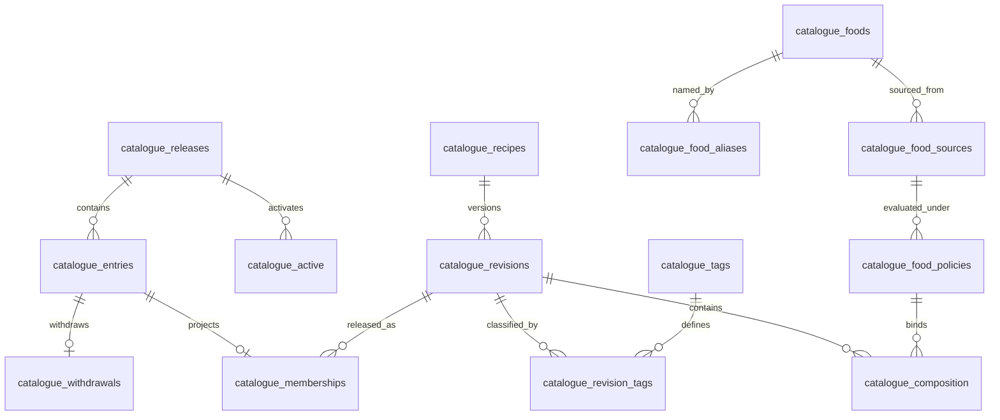

# Implemented MyChef catalogue and SQLite storage

GORM and SQLite are the selected storage for the initial 1,000-user stage.
The catalogue relationships below describe the separately maintained offline
recipe pipeline at commit `79440d79755bf1b5c044ef7abb668f4bd0d88a13`, inspected
on 13 November 2026. Catalogue migration and model paths in this reference
belong to that pipeline. The application repository owns the account, menu,
favorite and shopping models. Catalogue deployment verification is pending.

## Catalogue relationships

The relationships come from `migrations/003_catalogue.sql`,
`migrations/004_catalogue_withdrawals.sql` and
`migrations/005_catalogue_master.sql` at the source commit above. Composite
foreign keys bind release membership to both the imported entry and the exact
recipe revision. Composition binds the revision to a food, source digest and
policy hash. The diagram omits user accounts and editorial journals because
they have separate ownership and lifecycle rules.

| Entity | Grain and key | Meaning |
| --- | --- | --- |
| `catalogue_releases` | One immutable release, `id` | Content digest, source digest, policy version and preview/published channel. |
| `catalogue_entries` | One recipe in a release, `(release_id,id)` | Imported immutable payload and selected revision. |
| `catalogue_active` | One pointer per channel, `channel` | Active release for preview or published planning. |
| `catalogue_recipes` | One logical recipe, `id` | Stable recipe identity across revisions and releases. |
| `catalogue_revisions` | One immutable definition, `(recipe_id,revision)` | Payload, metadata, source digest and policy version. |
| `catalogue_memberships` | One recipe in a release, `(release_id,recipe_id)` | Relates the entry to the normalized revision. |
| `catalogue_foods` | One canonical food, `id` | Name and preparation state; names alone are not identity. |
| `catalogue_food_aliases` | One food/name pair | Alternative names for the same food. |
| `catalogue_food_sources` | One food/source pair | Source name and nutrient payload. |
| `catalogue_food_policies` | One food/source/policy triple | Version-bound policy body used by composition. |
| `catalogue_composition` | One food per recipe revision | Ordered composition and exact decimal-text grams. |
| `catalogue_tags` | One version of a tag, `(key,version)` | Namespace and label. |
| `catalogue_revision_tags` | One revision/tag-version pair | Classification and its evidence. |
| `catalogue_withdrawals` | One withdrawn release entry | Reason, recorded revision and creation time. |

Tag meaning and recipe content can change independently. Both versions belong
in analytical joins. Release entries are immutable import records; normalized
master rows are derived projections, not a second independently writable recipe
source. GORM mappings are in `internal/store/catalogue_models.go` and
`internal/store/master_models.go` at the same commit.

## Reconciliation with the partner ERD

| Partner concept | Implemented equivalent or boundary |
| --- | --- |
| Recipes and RecipeVersions | `catalogue_recipes` and `catalogue_revisions`, with release membership preserving reproducibility. A mutable latest-version pointer cannot replace release identity. |
| Ingredients | Canonical `catalogue_foods`, aliases, preparation states and source bindings. Existing user-owned `ingredients` rows remain distinct saved-meal data. |
| RecipeVersionIngredients | `catalogue_composition`, including order, exact quantity and source/policy binding. |
| RecipeTags and RecipeTagMapping | Versioned `catalogue_tags` and `catalogue_revision_tags`, attached to revisions. |
| MealPlans and MealPlanMeals | Existing `menus` and saved `meals` retain owner, portions and recipe snapshots. `internal/store/menus.go:144-164` saves the selected recipe and ingredients transactionally. |
| ShoppingLists and ShoppingListItems | Existing owner/week shopping state includes selections and manual items. It must not be replaced merely to match the proposal's table names. |
| FavoriteRecipes | Existing owner-scoped favorites retain their saved recipe content and personal-recipe compatibility. |
| UserPreferences | Existing user preferences retain authentication, account lifecycle and ownership. Master-data import creates no users or preferences. |
| UserInventory | Future pantry concept. No inventory workflow is established by these catalogue tables. |
| Recipe images | Private files plus image ledger and manifest bindings. There is no SQL foreign key from catalogue master rows to the image ledger. |

The partner proposal is retained with the pipeline's design records. This
reconciliation describes the implemented catalogue and its relationships to
existing application identifiers, content and migrations.

## Images and history

`scripts/catalogue/editorial/images.ts:22-52` defines recipe, parent revision,
parent payload digest, staged draft, prompt, reference and brief bindings. The
operator ledger stores attempts separately; the manifest points to retained
image files. Recipe approval, image readiness and publication are distinct
states. Preserve their records and files together when backing up or moving
storage. A recipe database backup alone does not preserve image bytes or every
editorial journal.

## SQLite configuration and scaling

The app store enables WAL, foreign keys, a busy timeout and full synchronization
in `internal/store/open.go`. Its connection pool has one connection, so work
through that pool is serialized. The application lock also prevents a second
server from opening the same app database through the normal server startup
path. This is a single-instance deployment contract.

SQLite remains the selected engine. Catalogue normalization, query indexes and
analytical isolation can improve its use without an engine migration. A
representative load test must establish peak write behavior, connection waits,
query latency, lock failures, checkpoint growth and backup/restore times before
claiming capacity for a particular traffic pattern. The 1,000-user target is not
1,000 simultaneous writers.

## Analytical storage boundary

The owner also selected a
[curated SQLite analytical dataset](analytics-dataset.md). It has
its own schema version, database file, writer and read-only report access. It
does not use the app connection pool. Copy only approved facts through a
documented input contract. Analysts receive a curated extract, not the complete
account database or live filesystem access to it.

The first dataset starts with synthetic data. App event capture, real customer
ingestion, demographic collection, email/push attribution and scheduled reports
need the analytics feature's reviewed contracts and acceptance. Separate files and operating system access controls provide the access
boundary. SQLite views provide convenient query interfaces.

## Observed local snapshot

Read-only queries against a retained pipeline checkpoint on 13 November 2026
returned 5,500 logical recipes, 5,533 revisions, 64,923 composition rows and
19,532 release-entry rows. The complete database file was about 288 MiB. These
are retained local measurements, not a production benchmark or current image
approval totals. No application or recipe records were changed.
